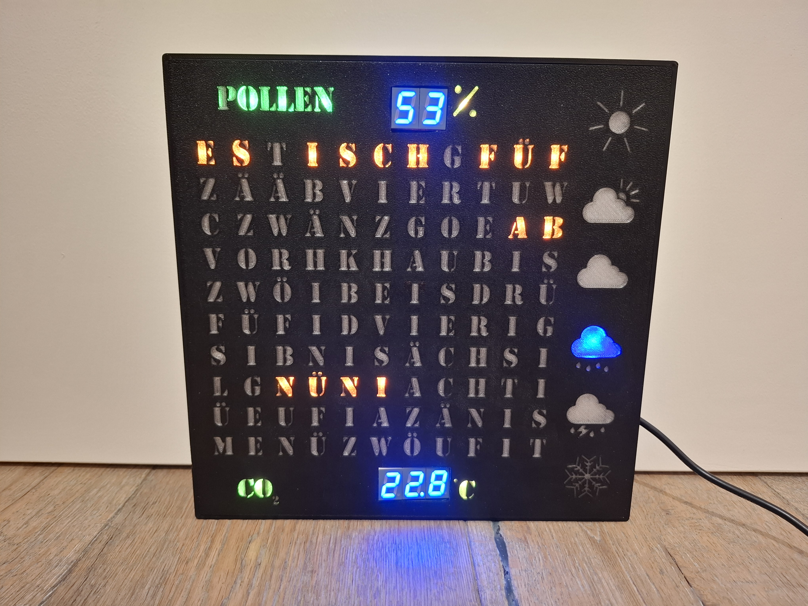

# Time-Tale - Die intelligente Word und Health Clock

Time-Tale ist eine innovative und ästhetisch ansprechende Text-Uhr, die die Funktionalität einer klassischen Word Clock mit erweiterten Gesundheits- und Umweltsensoren verbindet. 

Hauptfunktionen:

* Textbasierte Zeitanzeige: Die Uhrzeit wird in ausgeschriebenen Worten auf einem RGBW-LED-Display angezeigt, was eine moderne und visuell ansprechende Alternative zur traditionellen Zeitanzeige darstellt.

* Gesundheits-Dashboard: Time-Tale fungiert als eine "Health Clock" und überwacht wichtige Umgebungsparameter:

** CO₂-Messung: Über einen integrierten Sensor wird die Raumluftqualität erfasst und wird über Farbcodes visuel dargestellt.

** Temperatur- und Luftfeuchtigkeitsanzeige: Sensoren liefern Echtzeitdaten zur Innenraumtemperatur und Luftfeuchtigkeit.

** Pollen belastungsanzeige : Per Netzwerkverbindung wird der aktuelle Pollenflug ermittelt und wird über Farbcodes visuel dargestelltt.

* Smarte Zusatzfunktionen:

** Sprachausgabe: Die Uhrzeit wird zur vollen Stunde per Lautsprecher angegeben.

** Wetteranzeige & Tag/Nacht-Modus: Netzwerkbasierte Wetterdaten (Google Maps Platform Weather API) werden visualisiert. Bei Nacht passen sich die Wettersymbole an (z. B. weisser Mond statt gelbe Sonne) und alle LEDs können automatisch um einen konfigurierbaren Prozentsatz gedimmt werden.

** Dynamischer Gewitter-Effekt: Bei Gewitter leuchtet das Icon standardmässig blau und blitzt in zufälligen Zeitabständen gelb auf (konfigurierbare Blitzanzahl pro Stunde).

** Automatische Sommer-/Winterzeit (MESZ/MEZ): Automatische Zeitumstellung nach europäischem Standard (letzter Sonntag im März/Oktober), im Webportal konfigurierbar.

** Robustes Zeit- & Netzwerkmanagement: Die Uhrzeit läuft auch bei temporärem Ausfall der NTP-Verbindung kontinuierlich weiter. Bei Verbindungsverlust versucht die Uhr im AP-Modus alle 5 Minuten automatisch, die WLAN-Verbindung wiederherzustellen.

** Benutzerfreundlichkeit: Die Steuerung ist sowohl über einfache physische Tasten als auch über ein integriertes Webportal (Access Point oder lokales WLAN) möglich.

** Modernes Design: Alle Komponenten sind in einem kompakten, wohnraumtauglichen Gehäuse untergebracht, das Funktionalität und Ästhetik vereint.

## Troubleshooting

### Sichere Verbindung zu Google API herstellen

Für die Wetter- und Pollendaten wird eine HTTPS-Verbindung zu den Google APIs (`weather.googleapis.com` und `pollen.googleapis.com`) aufgebaut.
Im Google Cloud Projekt muss die **Google Maps Platform Weather API** und **Pollen API** aktiviert sein und ein gültiger API-Schlüssel im Webportal hinterlegt werden.
Die SSL-Verbindung wird direkt auf dem ESP32 verschlüsselt hergestellt; ein manuelles Einpflegen von Zertifikaten ist nicht mehr erforderlich.

### MP3-Player

Der MP3-Player spielt die Musik nicht anhand der der Namen von der Dateien ab. Dies ist nur eine Hilfe.
Er spielt die Songs anhand der Reihenfolge ab, wie sie auf die SD-Karte kopiert wurden.
Somit muss man alle Songs einzeln in der richtigen Reihenfolge auf die SD-Karte kopieren.

### W-Lan Verbindung

Der Arduino Nano esp32 kann sich nur mit W-Lan im 2,4 GHz bereich verbinden.
Somit muss darauf geachtet werden, dass das gewünschte W-Lan im 2,4 GHz Band zur verfügung steht.
Auf meinem Handy (Galaxy A55) musste ich extra den Hotspot umstellen. 

## ToDo's & Ideen:

- Die Textanzeige über einen String abdecken, welcher genau so wie die Deckplatte ist.
  Dann kann anschliessend über den string.getIndexOf("isch") der Start Index geholt werden. 
  Dadurch kann die Frontplatte angepasst werden, ohne dass man gross den Code ändern muss.

- Punkte um Minuten anzuzeigen

- Strom ausrechnen und entsprechend die Led's etwas Dimmen. -> Dadurch kann ein deutlich kleiners Netzteil genutzt werden.

- Funktionen:
  - Neujahr herunterzählen wo die Zahl über die gesammte Anzeige gemacht wird.
  - 1. August
  - Geburtstag

